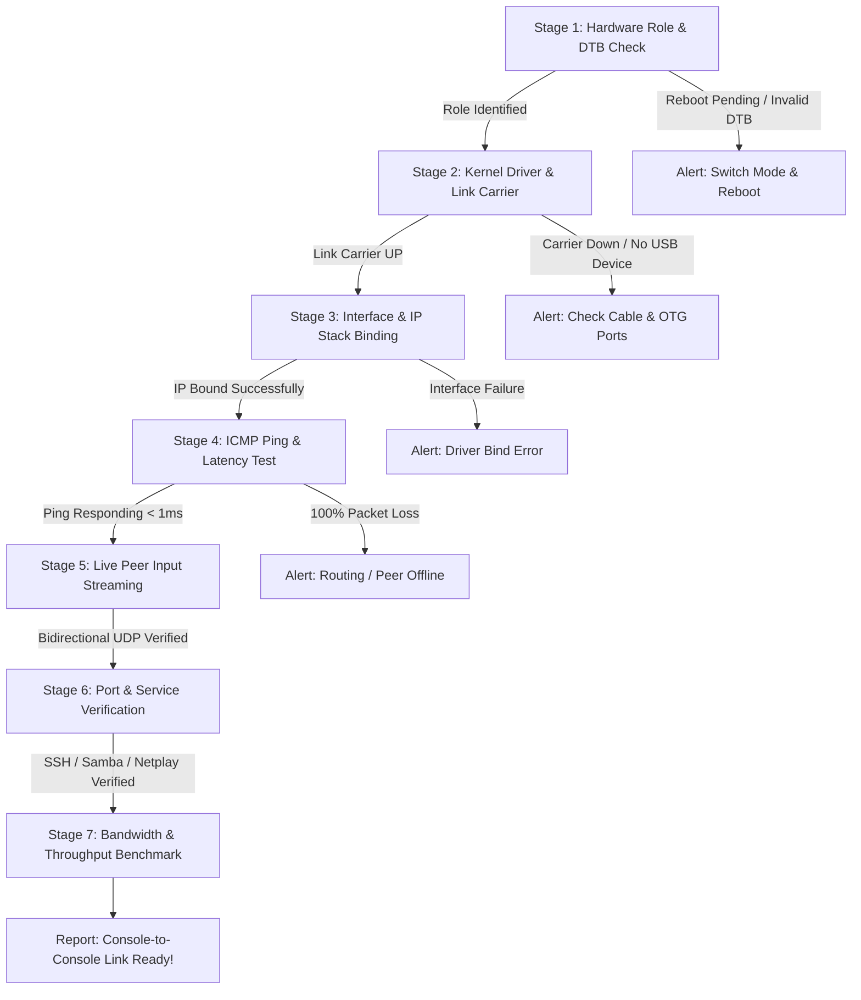

# 🎮 C2C (Console-to-Console) USB Connection Test Plan
> **Architectural Specification & Diagnostic Test Suite for Direct USB Wired Handheld-to-Handheld Communication (Battle XP G350 / Rockchip RK3326 on ArkOS / dArkOS)**

---

## 📌 1. Executive Summary & Objective

The objective of this project is to create an automated, reliable diagnostic script and connection utility for connecting **two retro handheld consoles directly together** via a USB cable.

In this setup:
* **Console A** operates as the **USB Host (Master)**.
* **Console B** operates as the **USB Peripheral / Gadget (Client)**.

This enables offline, zero-latency console-to-console capabilities without needing an external Wi-Fi router, PC, or internet connection:
1. **Interactive Real-Time Input Mirroring:** Each console displays the real-time physical button presses of the other console on its screen (e.g., Host displays Peripheral's gamepad inputs, and vice-versa) providing instant, tangible proof of bidirectional communication.
2. **Offline RetroArch Netplay:** Direct 2-player wired multiplayer with sub-1ms ping.
3. **Handheld-to-Handheld ROM & Save Sync:** High-speed peer-to-peer file transfer via SFTP/rsync.
4. **Direct Backup & Multi-Console Maintenance:** Managing or cloning save files directly between devices in the field.

The diagnostic script (`c2c_test.sh` / `C2C_Connection_Test.sh`) will run directly on the handheld screen (or via SSH), inspect the physical hardware role, configure the peer-to-peer network interface, test physical and IP layers, stream live gamepad inputs between consoles, probe essential gaming and transfer services, and display a clear, gamepad-friendly diagnostic report tailored for 3.5" handheld screens (max 42 columns × 16 rows).

---

## 🔌 2. Hardware & Physical Cabling Architecture

### 2.1 Hardware Roles on RK3326 Handhelds

| Parameter | Console A (USB HOST) | Console B (PERIPHERAL) |
| :--- | :--- | :--- |
| **Hardware Mode** | `USB HOST (OTG)` | `WIRED PC (Peripheral)` |
| **Active DTB** | `/boot/rk3326-g350-host.dtb` (`dr_mode = "host"`) | `/boot/rk3326-g350-peripheral.dtb` (`dr_mode = "peripheral"`) |
| **Kernel Subsystem** | Host Controller (`dwc2` / `ehci` host mode) | USB Gadget Controller (`/sys/class/udc/ff300000.usb`) |
| **Active Driver** | Host network class driver (`cdc_ether`, `rndis_host`, or `usbnet`) | USB Gadget driver (`g_ether`) |
| **VBUS Power** | Supplies 5V VBUS trigger (initiates USB bus enumeration) | Self-powered (battery-driven, accepts VBUS sense) |
| **Assigned Interface**| `usb0` (or host ethernet adapter `eth1`/`enp...`) | `usb0` (virtual USB Ethernet gadget) |
| **Assigned Static IP**| `192.168.10.1 / 24` | `192.168.10.2 / 24` |

---

### 2.2 Physical Port & Cable Considerations (Critical Hardware Realities)

Budget RK3326 handhelds (such as the Battle XP G350, RG351P/M/V, RK2020) present specific physical constraints that the test script and user manual must account for:

```
[Console A: HOST]                                      [Console B: PERIPHERAL]
+-------------------+                                  +-------------------+
| OTG Port (Host)   |====== USB-C to USB-C Cable ======| OTG Port (Gadget) |
| (5V Host Bus Out) |     (or USB-C OTG + A-to-C)      | (Device Endpoint) |
+-------------------+                                  +-------------------+
```

1. **Port Selection (OTG vs. DC):**
   * Handhelds typically have two Type-C ports: **`OTG`** and **`DC`** (charge-only).
   * **Both consoles MUST be plugged into their respective `OTG` ports.**
   * Plugging either console into the `DC` port results in charging only (no USB data lines are wired).

2. **C-to-C Cable & Configuration Channel (CC) Resistors:**
   * Many budget handhelds lack active Type-C CC pull-down / pull-up resistors (`Rp` / `Rd`) on their internal circuit boards.
   * A pure passive USB-C to USB-C cable may fail to trigger enumeration if neither port signals Host/Device orientation.
   * **Recommended hardware cabling setups:**
     * **Setup 1 (Best & Most Compatible):** USB-C Male to USB-A Female OTG adapter plugged into **Console A (Host)** + standard USB-A to USB-C cable plugged into **Console B (Peripheral)**.
     * **Setup 2:** A bi-directional Type-C to Type-C cable with OTG marker or directional Host-to-Device cable.

---

## 🌐 3. Network Architecture & Addressing Specification

### 3.1 Dedicated Subnet Design

To avoid any IP collisions with existing PC tethering configurations in `G350Wired`:
* `192.168.137.x`: Reserved for Windows Internet Connection Sharing (ICS).
* `192.168.7.x`: Reserved for Direct PC static mode.
* **`192.168.10.0 / 24`**: **Designated for Console-to-Console (C2C) Direct Link.**

```
+-------------------------------------------------------------------------------+
|                        SUBNET: 192.168.10.0 / 24                              |
|                                                                               |
|   Console A (HOST)                                   Console B (PERIPHERAL)   |
|   IP: 192.168.10.1                                   IP: 192.168.10.2         |
|   Subnet Mask: 255.255.255.0                         Subnet Mask: 255.255.255.0|
|   Target Peer: 192.168.10.2                          Target Peer: 192.168.10.1|
+-------------------------------------------------------------------------------+
```

### 3.2 IP Configuration & Interface Negotiation
* **Zero-DHCP Dependency:** Embedded P2P setups cannot rely on DHCP servers running or leasing IPs. The script will statically assign the respective IPs with zero delay.
* **Persistent Secondary Binding:** The script adds `192.168.10.x/24` to `usb0` without dropping other subnets if other services are concurrently active.

---

## 🎮 4. Real-Time Peer Gamepad Input Mirroring Architecture

### 4.1 Concept & Purpose
Static metrics (like ping time) tell the user a route exists, but they do not provide intuitive feedback. **Peer Input Mirroring** bridges this gap:
* While the script runs, **Console A (Host) continuously reads and displays the live button presses of Console B (Peripheral)**.
* Concurrently, **Console B (Peripheral) displays the live button presses of Console A (Host)**.
* When a player on Console B taps `[A]`, pulls `[R1]`, or pushes `[▲ Up]`, the Host's screen **instantly lights up those inputs in real time (<1ms latency)**.

```
Console A (Host)                                     Console B (Peripheral)
+-------------------------+                          +-------------------------+
| Local Gamepad           |                          | Local Gamepad           |
| Reads: [ ] [ ]          |                          | Player presses: [A] [X] |
|                         |  <=== UDP 5005 Pkt <===  |                         |
| Remote Display:         |  (Bitmask: 0x0005)       | Remote Display:         |
| PEER INPUT: [A] [X]     |                          | PEER INPUT: [ ] [ ]     |
+-------------------------+                          +-------------------------+
```

---

### 4.2 Technical Implementation Details

1. **Gamepad Input Capture:**
   * **ArkOS Native Method:** Directly samples ArkOS's hardware button monitor (`/usr/local/bin/buttonmon.sh` routines `Test_Button_A`, `Test_Button_B`, `Test_Button_X`, `Test_Button_Y`, `Test_Button_Up`, `Test_Button_Down`, `Test_Button_Left`, `Test_Button_Right`, `Test_Button_L1`, `Test_Button_R1`).
   * **Linux Evdev / Joystick Fallback:** Reads `/dev/input/event*` or `/dev/input/js0` directly via a lightweight 30-line Python or C/Bash binary loop.

2. **Ultra-Low-Latency UDP Transport (Port 5005):**
   * **Protocol:** UDP (User Datagram Protocol) over `192.168.10.x`.
   * **Why UDP?** Zero-handshake, no TCP head-of-line blocking. Packets are streamed at 30–60 Hz (~16ms intervals). If a single packet drops, the next frame supersedes it immediately.
   * **Payload Structure:** 
     * *Compact Bitmask (2 Bytes / 16 bits):*
       * `Bit 0`: Button A (1 = pressed, 0 = released)
       * `Bit 1`: Button B
       * `Bit 2`: Button X
       * `Bit 3`: Button Y
       * `Bit 4`: D-Pad UP
       * `Bit 5`: D-Pad DOWN
       * `Bit 6`: D-Pad LEFT
       * `Bit 7`: D-Pad RIGHT
       * `Bit 8`: L1
       * `Bit 9`: R1
       * `Bit 10`: L2
       * `Bit 11`: R2
       * `Bit 12`: Select
       * `Bit 13`: Start
     * *Plaintext ASCII Alternative (for pure bash compatibility):*
       `INP:A=1,B=0,X=1,Y=0,U=0,D=0,L=0,R=0,L1=0,R1=0,SEL=0,STA=0`

3. **Rendering on Handheld Display:**
   * Input states are rendered dynamically on the screen using ANSI color highlights:
     * **Pressed:** Highlighted in bold green/yellow: `[A]`, `[▲]`, `[R1]`.
     * **Idle/Released:** Dimmed gray placeholder: `[ ]` or `·`.
   * A heart-beat activity indicator (`●` / `○`) shows whether remote input packets are flowing continuously.

---

## 🧪 5. Diagnostic Verification Pipeline (The 7 Stages)



---

### Detailed Stage Breakdown:

### 🔬 Stage 1: Local Hardware Role & DTB Validation
* Read `/proc/device-tree/usb@ff300000/dr_mode` and compare `/boot/rk3326-g350-linux.dtb` against `/boot/rk3326-g350-host.dtb` and `/boot/rk3326-g350-peripheral.dtb`.
* Determine role automatically:
  * If `dr_mode == "host"` -> **Role: HOST** (Target peer: `192.168.10.2`).
  * If `dr_mode == "peripheral"` -> **Role: PERIPHERAL** (Target peer: `192.168.10.1`).
* Warn if a mode switch reboot is pending or if DTB is unconfigured.

### 🔌 Stage 2: Kernel Driver & Physical Link Detection
* **On Peripheral:**
  * Ensure `g_ether` is loaded (`lsmod | grep -q g_ether`). If missing, execute `sudo modprobe g_ether`.
  * Check physical link carrier: `/sys/class/net/usb0/carrier`.
  * Carrier = `1` means Host has applied VBUS / clock and enumerated the device.
* **On Host:**
  * Check `lsusb` or `/sys/bus/usb/devices/` for the presence of the Gadget device (`ID 0525:a4a2` or Linux USB Ethernet Gadget).
  * Check that `cdc_ether` / `rndis_host` / `usbnet` has bound an interface (`usb0`, `eth1`, etc.).

### 📶 Stage 3: Network Interface & IP Configuration
* Ensure the target interface is administratively UP: `sudo ip link set dev <IFACE> up`.
* Check if `192.168.10.x` is already assigned to the interface. If missing, bind `sudo ip addr add 192.168.10.x/24 dev <IFACE>`.
* Set an explicit direct route to the peer: `sudo ip route replace 192.168.10.0/24 dev <IFACE>`.

### 🏓 Stage 4: ICMP End-to-End Ping & Latency Analysis
* Send 5 ICMP echo requests to the peer console (`ping -c 5 -W 1 $PEER_IP`).
* Extract metrics:
  * **Packet Loss:** Must be 0% for a clean wired link.
  * **Min / Avg / Max Latency:** Expected latency across direct USB 2.0 High-Speed bus is **0.2ms – 0.6ms** (sub-millisecond).
  * **Jitter Evaluation:** Alert if packet variance exceeds 2ms.

### 🎮 Stage 5: Live Peer Input Streaming & Mirroring
* Launch background input transmitter to `$PEER_IP:5005` via UDP.
* Open non-blocking UDP listener on local port `5005`.
* Display the **Current Input** section on screen:
  * When peer presses buttons, active indicators immediately illuminate.
  * Confirms full bidirectional packet exchange and socket stack operation.

### 🚪 Stage 6: Service Probing (Netplay & File Transfer Readiness)
* **SSH / SFTP (TCP Port 22):** Probe peer port 22 via raw TCP socket `(exec 3<>/dev/tcp/$PEER_IP/22)`.
  * *Purpose:* Verifies ability to perform handheld-to-handheld file copying, save backup, and remote command execution.
* **Samba File Sharing (TCP Port 445):** Probe peer SMB server.
* **RetroArch Netplay (TCP/UDP Port 55435):** Test if RetroArch Netplay port is accessible.

### ⚡ Stage 7: Bandwidth & Throughput Benchmark (Optional Quick Benchmark)
* Run a lightweight 3-second network throughput test between the consoles using `nc` (netcat) or raw socket stream.
* Benchmark target:
  * Expected throughput: **18 MB/s – 28 MB/s** (150 Mbps – 220 Mbps over USB 2.0 High Speed).
  * Flags a warning if speed drops below 5 MB/s (indicating USB 1.1 Full-Speed fallback or bad cable contact).

---

## 💻 6. Script Architecture & UI Specification

### 6.1 Design Principles
1. **Single Unified Script (`C2C_Connection_Test.sh`):**
   * The exact same script can be copied to BOTH consoles.
   * Auto-detects whether the running console is Host or Peripheral and adapts tests automatically.
   * Includes manual CLI flags (`--host`, `--peripheral`, `--live-input`, `--json`, `--continuous`) for advanced use or automated scripts.
2. **Compact 3.5" Handheld Screen Form Factor & Zero-Flicker Architecture:**
   * Strictly formatted for 42 columns and 16 rows maximum to fit the native ArkOS Terminus font (`Lat7-TerminusBold28x14.psf.gz`) with **zero line wrap or visual distortion**.
   * **Zero-Flicker In-Place Redraw:** Uses ANSI cursor home (`\033[H`) to overwrite text lines in-place without terminal reset (`\033c`) wipes, eliminating screen flashing and blackouts.
   * **Capped Non-Blocking Probes:** Network probes (ping, SSH, Netplay) use strict timeouts (≤ 350ms) to prevent any UI freezes when the peer is disconnected.
3. **Gamepad Driven & Dedicated [START + SELECT] Exit:**
   * Integrates `/usr/local/bin/buttonmon.sh` on ArkOS and direct `/dev/input/` event monitoring:
     * **ONLY hold `[START + SELECT]`** exits the script, leaving all other gamepad buttons free for interactive testing.
     * Single buttons (such as `[B]` or `[A]`) do NOT trigger exit.
     * Terminal emergency exit: `Ctrl+C` / `Ctrl+D` (SIGINT trap).
4. **Clean Pure-ASCII String Rendering (No Sed Mangling):**
   * Python directly formats the 3 input visualizer rows with native ASCII and true ESC bytes (`\x1b[1;32m`).
   * Bash reads with native `read -r` and prints with `printf "%s"`, completely eliminating `sed` character corruption, subshell command errors, and weird characters.

---

### 6.2 Handheld Screen Mockup with Live Input Section (42 Columns × 16 Rows)

```
==========================================
   C2C DIRECT USB CONNECTION CHECKER    
==========================================
 LOCAL ROLE : [HOST] (192.168.10.1)      
 PEER ROLE  : [PERIPHERAL] (192.168.10.2)
 CABLE LINK : CONNECTED [CARRIER OK]      
 PING/RTT   : 0% LOSS (avg 0.35ms) [OK]  
 SSH / SFTP : PORT 22 LISTENING  [READY] 
------------------------------------------
 PEER GAMEPAD INPUT (Live from Remote):   
 DPAD: [U][D][L][R]   BTNS: [A][B][X][Y]  
 TRIG: [L1][R1][L2][R2]  OPTS: [SEL][STA] 
 JOY : [U][D][L][R]   STREAM: LIVE (*)    
------------------------------------------
 EXIT COMBO: HOLD [START + SELECT]        
==========================================
```

#### Detailed Breakdown of the Peer Input Display:
* **`DPAD`**: Shows physical D-Pad: `[U]`, `[D]`, `[L]`, `[R]` (Buttons 6, 7, 8, 9 on RK3326).
* **`BTNS`**: Shows face buttons: `[A]`, `[B]`, `[X]`, `[Y]` (Buttons 1, 0, 3, 2).
* **`TRIG`**: Shows shoulder/triggers: `[L1]`, `[R1]`, `[L2]`, `[R2]` (Buttons 4, 5, 11, 14).
* **`JOY`**: Shows analog joystick directions: `[U]`, `[D]`, `[L]`, `[R]` (Axes 0, 1).
* **`OPTS`**: Shows menu buttons: `[SEL]` (Button 10) and `[STA]` (Button 15).
* **`STREAM`**: Pulsing activity indicator (`*` / `o`) confirming live packet reception over UDP.

---

## ⚠️ 7. Diagnostic & Troubleshooting Matrix

| Symptom | Probable Cause | Script Detection & User Guidance |
| :--- | :--- | :--- |
| **Both consoles report "HOST"** | Both consoles booted with `rk3326-g350-host.dtb`. | ⚠️ *"Conflict: Both consoles are in HOST mode. On Console B, launch USB Network Manager and press [X] to switch to Peripheral mode."* |
| **Both consoles report "PERIPHERAL"** | Both consoles booted with peripheral DTBs; neither provides VBUS or host enumeration. | ⚠️ *"Conflict: Both consoles are in PERIPHERAL mode. On Console A, switch to USB HOST mode and reboot."* |
| **Carrier DOWN / Interface missing on Host** | Cable plugged into charge-only **`DC`** port instead of **`OTG`** port. | ⚠️ *"Physical link down! Ensure cable is connected to the OTG port on both handhelds (not the DC charging port)."* |
| **Carrier DOWN with C-to-C cable** | Passive USB-C cable lacks CC pull-down resistors for budget handhelds. | ⚠️ *"No USB data connection. Use a USB-C OTG adapter on the Host console or an OTG-rated cable."* |
| **Carrier UP, but Ping 100% loss** | Interface UP but IP address unassigned or route missing. | ⚠️ *"Physical link active, but IP unreachable. Re-binding 192.168.10.x and refreshing routes."* |
| **Ping OK, but Peer Input shows "NO STREAM"** | Input daemon blocked by firewall or script not running on peer console. | ⚠️ *"Ping is active, but no input packets on UDP 5005. Launch C2C_Connection_Test.sh on the second console."* |
| **Ping OK (<1ms), but SSH Port 22 closed** | Peer console has not launched SSH daemon. | ⚠️ *"Ping successful! On peer console, launch USB Network Manager and press [A] to start SSH/Samba."* |
| **Transfer speed < 1.5 MB/s** | Link negotiated at USB 1.1 Full Speed instead of USB 2.0 High Speed. | ⚠️ *"Sub-optimal connection speed detected. Re-insert cable firmly into OTG port."* |

---

## 🚀 8. Step-by-Step Implementation Roadmap

```mermaid
flowchart LR
    M1[Milestone 1:<br/>Diagnostic Core Script] --> M2[Milestone 2:<br/>P2P Auto-Configurator]
    M2 --> M3[Milestone 3:<br/>Live Input Streamer (UDP 5005)]
    M3 --> M4[Milestone 4:<br/>Gamepad UI & Visual Feedback]
    M4 --> M5[Milestone 5:<br/>C2C Save Sync & Netplay Helper]
```

### Milestone 1: Core Diagnostic Logic (`C2C_Connection_Test.sh`)
* Implement role detection via `/proc/device-tree/usb@ff300000/dr_mode` and DTB signature.
* Implement carrier checks (`/sys/class/net/*/carrier`) and `lsusb` parsing.
* Implement non-blocking ICMP ping test with latency statistics extraction.
* Implement socket probing for Port 22 (SSH) and Port 55435 (Netplay).

### Milestone 2: P2P Network Auto-Configurator
* Add self-healing routine: if interface is present but lacks `192.168.10.x`, automatically configure the appropriate IP based on detected role.
* Flush stale routes and set direct device subnet route.

### Milestone 3: Live Gamepad Input Streamer & Receiver
* Build lightweight UDP sender and receiver routines (port `5005`).
* Interface with ArkOS button definitions (`buttonmon.sh`) and Linux `/dev/input/js0`.
* Encode button states into compact bitmasks.

### Milestone 4: Handheld Gamepad Interface & Screen Formatting
* Format display output for ArkOS console framebuffer (`/dev/tty0` / `/dev/tty1`).
* Render real-time remote gamepad visualizer on 42-column layout.
* Bind gamepad buttons (`[A]` re-test, `[Y]` full input HUD, `[B]` exit).

### Milestone 5: Quick-Action Helpers & Documentation
* Create a companion transfer script `c2c_sync_saves.sh` demonstrating high-speed save file synchronization between the two connected consoles.
* Create a beginner-friendly markdown guide `C2C_QUICK_START.md` with photos and diagram instructions.

---

## 📁 9. Files to be Created in `C2Cconnection/`

| File Name | Purpose |
| :--- | :--- |
| **`PLAN.md`** *(This document)* | Complete technical specification and architectural plan. |
| **`C2C_Connection_Test.sh`** | Main interactive connection verification script for handhelds (includes live peer input section). |
| **`C2C_Netplay_Prep.sh`** | 1-Click RetroArch Netplay initializer; patches `retroarch.cfg` (disables relay/UPnP) and binds P2P IPs. |
| **`c2c_setup.sh`** | Lightweight headless script to bind C2C static IPs and initialize drivers. |
| **`C2C_QUICK_START.md`** | Community tutorial with cable diagrams and RetroArch Netplay setup instructions. |

---

*Authored for the G350Wired Project & Retro Handheld Community.*
