# 🎮 BatleXP G350 USB Network Manager: Complete Community Guide & Tutorial

> **Author:** Community Release / G350 Wired Project  
> **Target Devices:** BatleXP G350 and compatible Rockchip RK3326 handheld consoles (RG351P, RGB20S, RK2020) running **dArkOS / ArkOS**.  
> **Interface:** Single-file gamepad utility (`USB_Network_Manager.sh`) tailored for 3.5" handheld screens.

---

## 📖 1. What is This Tool?

Many budget handheld retro consoles like the **BatleXP G350** have powerful Rockchip RK3326 processors but **no internal Wi-Fi chip**. Traditionally, adding games or downloading updates required physically removing the MicroSD card every time, putting it into a PC reader, and reinserting it. This causes wear on the delicate spring slot, risks corrupting save files, and makes using tools like **PortMaster** or the **box-art scraper** nearly impossible without external dongles.

**USB Network Manager** transforms your console's physical USB-C port into a **high-speed bidirectional networking bridge** connected directly to your PC with a single USB cable.

### What it gives you:
* 🌐 **Full Internet Access on the Console:** Download games directly in **PortMaster**, scrape box art and metadata in **EmulationStation**, and update **RetroArch** cores/cheats through PC Internet Tethering.
* ⚡ **High-Speed ROM Transfers (SFTP):** Connect with **WinSCP**, **FileZilla**, or **Cyberduck** on Port 22 (`ark`/`ark`) to transfer multi-gigabyte PS1, Dreamcast, and N64 ROMs at native USB 2.0 speeds (~25–35 MB/s).
* 📁 **Windows File Explorer Integration (Samba):** Access your games folder directly from Windows Explorer at `\\192.168.137.2\roms` as a network drive.
* 🕹️ **Zero Clutter:** A single, self-contained file in your **TOOLS** (recommended) or **PORTS** menu that handles mode switching, IP configuration, gateway routing, and service management with full gamepad navigation.

---

## 🔌 2. Hardware Requirements

Before starting, make sure you have the right cable:

| Component | Requirement | Why? |
| :--- | :--- | :--- |
| **Console** | BatleXP G350 (dArkOS / ArkOS) | Tested on RK3326 kernel with `g_ether` gadget driver. |
| **Cable** | **USB-A to USB-C Data Cable** | **CRITICAL:** Use a standard USB-A to USB-C cable (USB-A to PC, USB-C to handheld). |
| **PC** | Windows 10 or 11 | Connected to home Wi-Fi or Ethernet. |

> [!CAUTION]
> **Avoid USB-C to USB-C cables!**  
> Budget handheld consoles lack dual 5.1kΩ CC pull-down resistors on their USB-C ports. Using a USB-C to USB-C cable from a modern laptop or motherboard will not negotiate power or data lines. Always use a standard **USB-A (PC) to USB-C (handheld)** data cable.

---

## 💾 3. First-Time Setup: Transfer & Paste to Your Console First!

> [!IMPORTANT]
> **This tool must be transferred and pasted onto your console BEFORE you can use it.**  
> `USB_Network_Manager.sh` is a completely self-contained, single-file script. You do not need to install packages or extract complex folders onto your device—simply copy this single `.sh` file into one of your console's system folders.

### 📁 Where to Paste the Tool: `tools/` vs `ports/`

You have two choices for where to paste `USB_Network_Manager.sh` on your console's storage. We **strongly recommend the `tools/` folder**:

| Destination Folder | Recommendation | Where It Shows in EmulationStation | Why Choose This? |
| :--- | :---: | :--- | :--- |
| **`tools/`** | **⭐ STRONGLY RECOMMENDED** | Under the **TOOLS** system menu | **Best organization.** Keeps system utilities (PortMaster, ThemeMaster, USB Network Manager) grouped together and keeps your games list clean. |
| **`ports/`** | Alternative Option | Under the **PORTS** games menu | Useful if your custom EmulationStation theme hides the Tools section, or if you prefer running all custom scripts from Ports. |

#### 📂 Visual Folder Structure on Your MicroSD Card:

**⭐ Recommended Setup (`tools/` folder):**
```text
MicroSD Card (EASYROMS or roms)
├── bios/
├── roms/
├── tools/                        <-- ⭐ RECOMMENDED DESTINATION
│   ├── USB_Network_Manager.sh    <-- Paste file here!
│   ├── PortMaster.sh
│   └── ThemeMaster.sh
└── ports/
    └── (Your port games: Apotris, Cave Story, etc.)
```

**Alternative Setup (`ports/` folder):**
```text
MicroSD Card (EASYROMS or roms)
├── bios/
├── tools/
└── ports/                        <-- ALTERNATIVE DESTINATION
    ├── USB_Network_Manager.sh    <-- Paste file here
    └── (Your port games)
```

---

### 📝 Step-by-Step Transfer Guide

Follow these steps to copy the tool to your console for the first time:

#### Step 1: Safely Shut Down Your Handheld
Never pull out a MicroSD card while the console is powered on, as this can corrupt filesystem data.
* On your console, press `START` to open the Main Menu.
* Select **Quit** -> **Shutdown System** -> Confirm **Yes**.
* Wait until the screen and power LED turn completely off.

#### Step 2: Remove the MicroSD Card
* **Dual-Card Consoles (e.g. BatleXP G350, RG351V, RGB20S):**  
  Remove the card from the **TF2 / EXT / GAME** slot (the secondary slot containing your ROMs and tools).
* **Single-Card Consoles:**  
  Remove the card from the **TF1 / OS** slot.

#### Step 3: Insert into PC & Open the Storage Partition
* Insert the MicroSD card into your computer's card reader or USB adapter.
* Open Windows File Explorer (`Win + E`).
* Open the drive labeled **`EASYROMS`** (or `roms`).

#### Step 4: Paste `USB_Network_Manager.sh`
* In the `EASYROMS` drive, open the **`tools`** folder (recommended) or the **`ports`** folder.
* Copy **`USB_Network_Manager.sh`** and paste it directly inside that folder.

#### Step 5: Safely Eject and Power On
* Right-click the MicroSD drive letter in Windows File Explorer and click **Eject**.
* Insert the card back into your handheld's slot.
* Power on the console.

#### Step 6: Locate in EmulationStation

* **If you pasted into `tools/` (Recommended):**  
  In EmulationStation, press **START** to open the Main Menu, and go to **OPTIONS**:  

  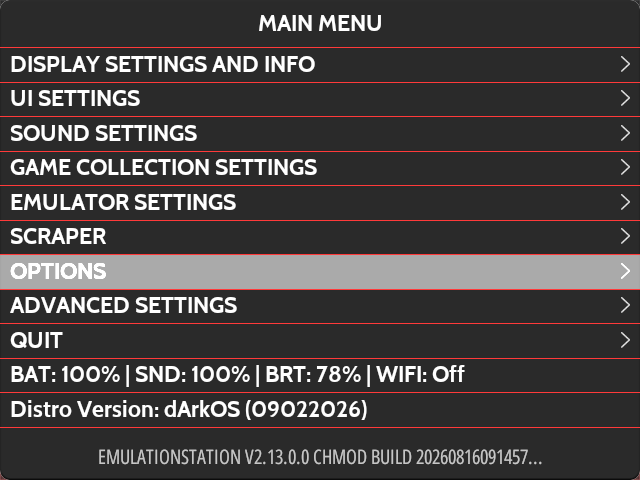  
  *Figure 1: Press START to open the Main Menu and go to OPTIONS.*  

  Inside the Options list, select **Tools**:  

  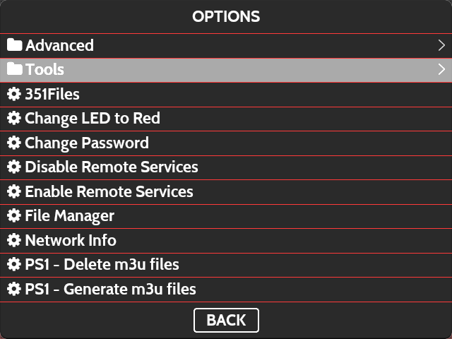  
  *Figure 2: Select Tools.*  

  You will see **`USB_Network_Manager`** listed alongside *PortMaster* and *ThemeMaster*:  

  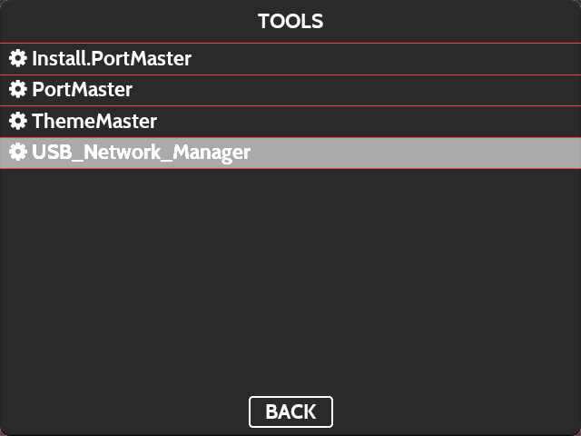  
  *Figure 3: USB_Network_Manager inside the Tools menu.*

* **If you pasted into `ports/` (Alternative):**  
  Navigate to the **PORTS** section on the main carousel:  

  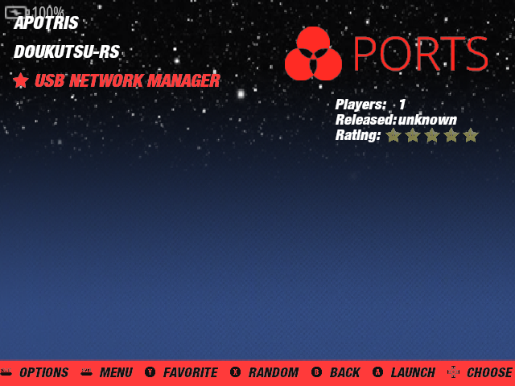  
  *Figure 4: USB Network Manager in the Ports list.*

> [!TIP]
> **Want to refresh without restarting?**  
> If you transferred the file over an existing connection or while EmulationStation was running, you don't need to reboot the console:  
> 1. Open any game collection (e.g., **Ports**, **GBA**, **SNES**, etc.).  
> 2. Press **`SELECT`** on your handheld.  
> 3. Choose **Update Game List**.  
> 
> The new entry will be scanned and appear immediately!

---

## 🕹️ 4. Preparing Your Console (Switch Mode & Start Services)

> [!IMPORTANT]
> **CRITICAL ORDER OF OPERATIONS:**  
> You MUST configure and start wired services on your console **before** setting up your Windows PC!  
> If the console is in USB Host mode or hasn't started its USB gadget driver (`g_ether`), your computer will not detect any USB device at all, and no network adapter will appear in Windows.

### Step 1: Connect the USB Cable
* Plug the standard **USB-A** end into your Windows PC.
* Plug the **USB-C** end into the console's **OTG / DC** port.

### Step 2: Open USB Network Manager
* On your console, navigate to **TOOLS** (recommended) or **PORTS** in EmulationStation.
* Launch **`USB Network Manager`**.

### The On-Screen Display:
The menu provides a live overview of your connection and hardware mode directly on your console's screen:

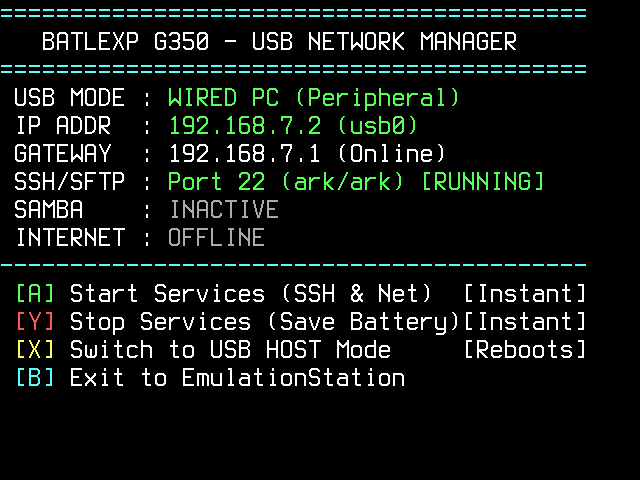  
*Figure 5: Live USB Network Manager dashboard on the BatleXP G350 display.*


### Gamepad Controls:

| Button | Function | When to Use |
| :---: | :--- | :--- |
| **[X]** | **Switch Hardware Mode** *(Reboots, 5s)* | Toggles the hardware USB PHY between **Wired PC** and **USB Host**. Check `USB MODE`: if it shows `USB HOST`, press **[X]** now to switch to `WIRED PC Mode` (the console will save and reboot). |
| **[A]** | **Start Wired Services** *(Instant, ~2s)* | Loads the `g_ether` gadget driver, binds IP `192.168.137.2`, and launches OpenSSH & Samba. **This creates the virtual network adapter that Windows will recognize.** |
| **[Y]** | **Stop Services (Battery Saver)** *(Instant, ~1s)* | Run this when you unplug the cable to turn off background daemons and save battery while gaming. |
| **[B]** | **Exit** | Returns cleanly to EmulationStation. |

### Step 3: Check Mode & Press [A]
1. Look at **`USB MODE`** at the top of the screen:
   * If it says **`WIRED PC (Peripheral)`**: You are in the right mode!
   * If it says **`USB HOST (OTG Pendrives)`**: Press **`[X]`** to switch to Wired PC mode. Allow the console to reboot, then relaunch **USB Network Manager**.
2. Press **`[A]`** (*Start Services*).
3. In ~2 seconds, the console initializes the USB Ethernet interface (`usb0`) and starts OpenSSH and Samba.

> [!TIP]
> Now that the console's USB Ethernet gadget is live, Windows will play a connection chime and detect the new adapter. You can now configure Windows Internet Connection Sharing!

---

## 🖥️ 5. Windows PC Setup: Enable Internet Connection Sharing (One-Time Setup)

Now that your console is running in Wired PC mode with services active, configure Windows to share its internet connection:

1. On your Windows PC, press `Win + R`, type `ncpa.cpl`, and hit **Enter** to open **Network Connections**:  

   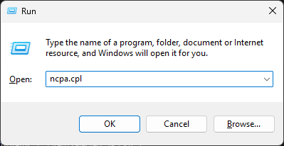  
   *Figure 6: Press Win + R and enter ncpa.cpl.*

2. You will now see your primary internet adapter (e.g., **Wi-Fi**) and the newly detected console USB adapter (typically named **Ethernet 2** with device description `Remote NDIS Compatible Device` or `USB Ethernet/RNDIS Gadget`).
3. **Right-click your active Wi-Fi adapter** (or primary Ethernet adapter) -> Select **Properties**:  

   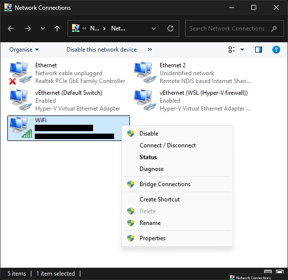  
   *Figure 7: Right-click your active Wi-Fi adapter and select Properties.*

4. Click the **Sharing** tab at the top.
5. Check the box:  
   `[✓] Allow other network users to connect through this computer's Internet connection`
6. In the dropdown under *Home networking connection*, select your console's adapter (e.g. **Ethernet 2**).
7. Click **OK**:  

   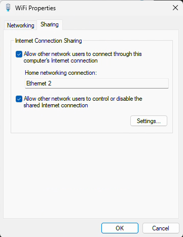  
   *Figure 8: Configure Internet Sharing for Ethernet 2.*

> [!TIP]
> **Instant Live Verification:** Look at your console screen!  
> Within a few seconds of clicking OK, **`GATEWAY`** will change to `192.168.137.1 (Online)` and **`INTERNET`** will change to `ONLINE (PortMaster Ready)`. You are fully connected and ready to go!

> [!CAUTION]
> **Important: Wi-Fi Sharing vs. File Transfers (SSH / SFTP):**  
> When transferring files, **Windows cannot be sharing Wi-Fi**, otherwise SSH will not connect with the console.  
> * **When using Internet on the console (PortMaster / Scraper / Updates):** Wi-Fi sharing should be **ON**.  
> * **When transferring ROMs & files (WinSCP / FileZilla / SSH):** Wi-Fi sharing must be **OFF** (uncheck sharing in `ncpa.cpl`).  
> *(We have noted this behavior and will work on a fix so both can work simultaneously without manual toggling in a future update).*

---

## 🚀 6. Daily Workflows

### Workflow A: Downloading Games with PortMaster (No Wi-Fi Needed)
1. Plug the USB cable from your PC into the console's **OTG / DC** port.
2. Launch **USB Network Manager** from **TOOLS** (or **PORTS**).
3. Press **[A]** (*Start Services*). In 2 seconds, you will see `INTERNET : ONLINE`.
4. Ensure Windows Wi-Fi sharing is **ON** in `ncpa.cpl`.
5. Press **[B]** to exit to EmulationStation.
6. Open **PortMaster** (in Ports or Tools) and browse/download ports directly over your PC's internet!
7. Once finished, open **USB Network Manager** and press **[Y]** to power down background daemons and conserve battery.

### Workflow B: Transferring ROMs via Windows File Explorer (Samba)
> [!NOTE]
> Ensure Windows Wi-Fi sharing is **OFF** in `ncpa.cpl` while transferring files, otherwise Windows firewall/NAT routing can block access to the console.

1. Plug in the USB cable and press **[A]** in **USB Network Manager**.
2. On your Windows PC, press `Win + E` to open File Explorer.
3. In the address bar at the top, type:  
   `\\192.168.137.2\roms`  
   and press **Enter**.
4. Drag and drop your game files directly into your console's console folders (`gba`, `snes`, `psx`, etc.).

### Workflow C: Transferring ROMs via SFTP (WinSCP / FileZilla)
> [!WARNING]
> **Windows Wi-Fi Sharing Must Be OFF:**  
> When transferring files, Windows cannot be sharing Wi-Fi, otherwise SSH will not connect with the console. Open `ncpa.cpl`, right-click Wi-Fi -> Properties -> Sharing, and uncheck the box before connecting with WinSCP or FileZilla.

> [!TIP]
> **Don't have WinSCP installed?**  
> If you don't have an SFTP client on your PC, download the free official installer here:  
> 📥 **[Download WinSCP (Official Site)](https://winscp.net/eng/download.php)**

1. Plug in the USB cable and press **[A]** in **USB Network Manager**.
2. Ensure Windows Wi-Fi sharing is turned **OFF**.
3. Open **WinSCP** on your PC. Click **+** or **New Tab** to add a new connection:  

   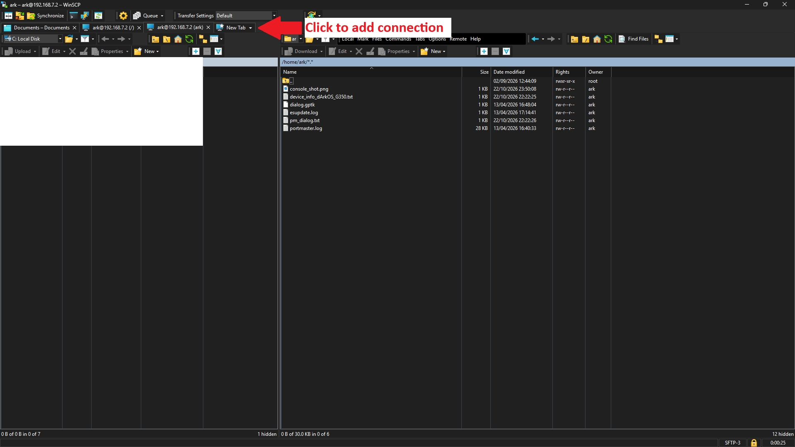  
   *Figure 9: Click + or New Tab to add a new connection in WinSCP.*

4. Configure your connection settings:  
   * **Protocol:** `SFTP`  
   * **Host:** `192.168.7.2` (or `192.168.137.2`)  
   * **Port:** `22`  
   * **Username:** `ark`  
   * **Password:** `ark`  

   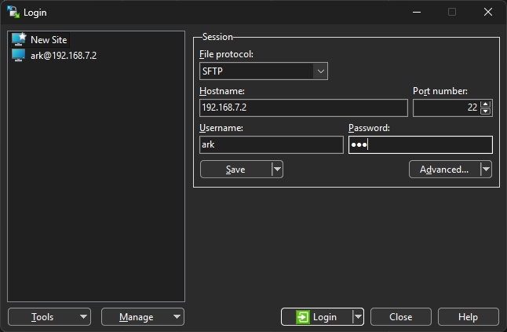  
   *Figure 10: WinSCP SFTP login parameters (192.168.7.2, port 22, ark / ark).*

   > [!TIP]
   > **Save Your Login for Next Time:**  
   > Click the **Save** button (located directly beneath the *Username* field). WinSCP will save this session to your site list on the left (e.g., as `ark@192.168.7.2`), so next time you can connect instantly with a single double-click without having to re-enter your IP address, username, or password!

5. Click **Login**. WinSCP connects and opens in `/home/ark/`.
6. To reach your games, click the path bar at the top:  

   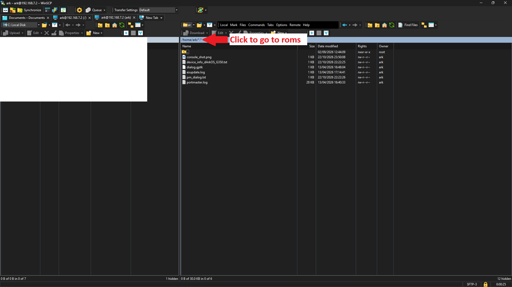  
   *Figure 11: Click the directory path bar to navigate to /roms/.*

7. Type **`/roms`** and click **OK**:  

   .png)  
   *Figure 12: Enter /roms to open your console's game folders.*

8. You now have full access to drag and drop ROMs directly into your system folders (`gba`, `snes`, `psx`, etc.) at native USB speeds (~25–35 MB/s)!

### Workflow D: Switching Between PC Mode and Flash Drive (Host) Mode
The Rockchip RK3326 chip uses different hardware transceiver configurations for connecting to a PC (Device/Peripheral) vs hosting USB drives (Host/OTG):

* **To connect a USB flash drive or external gamepad:**  
  Open **USB Network Manager** -> Press **[X]** (*Switch to USB HOST Mode*).  
  The console will save the setting and reboot in 5 seconds into USB Host mode.
* **To connect back to PC for internet/files:**  
  Open **USB Network Manager** -> Press **[X]** (*Switch to WIRED PC Mode*).  
  The console reboots in 5 seconds into Wired PC mode. Once back in EmulationStation, press **[A]** to start services!

---

## 🛠️ 7. Testing Your Connection from Windows

The project includes ready-to-run 1-click test utilities on your PC:

* **`Test_Internet_On_G350.bat`**: Pings the console, executes a remote ping to Google DNS (`8.8.8.8`) from inside the console, and tests DNS resolution (`github.com`).
* **`Test_Connection_G350.bat`**: Tests local physical cable link and SSH port 22 response.

Double-click **`Test_Internet_On_G350.bat`** on your PC to see live diagnostic output:

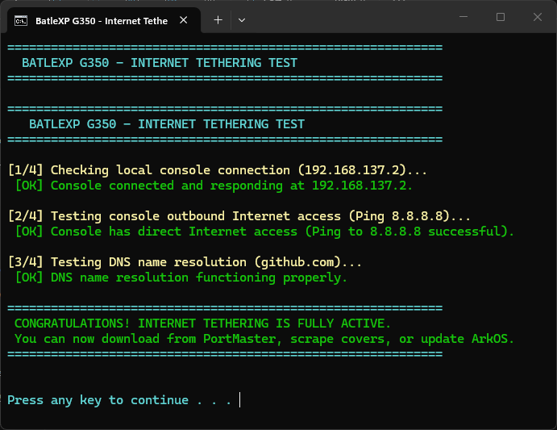  
*Figure 13: Live execution of Test_Internet_On_G350.bat showing all tests passing.*

---

## ❓ 8. Frequently Asked Questions & Troubleshooting

### Q: Why do I have to press [A] to start services instead of having it run automatically on boot?
**A:** ArkOS is an operating system optimized for battery longevity and fast game loading. Running persistent networking daemons on boot consumes CPU cycles, drains battery while playing games offline, and causes kernel race conditions with ArkOS's power management watchdogs. The 1-click on-demand design gives you instant access in 2 seconds only when you actually need it.

### Q: The Windows test says "Console is connected, but no Internet"?
**A:** This means your physical cable is working, but Windows Internet Connection Sharing (ICS) is not forwarding packets.
1. Open `ncpa.cpl` on your PC.
2. Right-click your active **Wi-Fi** adapter -> **Properties** -> **Sharing**.
3. **Uncheck** the sharing box, click **OK**, then reopen Properties and **re-check** the sharing box, selecting your console's Ethernet adapter. This refreshes the Windows NAT routing table.

### Q: Why does the screen say "REBOOT PENDING"?
**A:** You changed the USB mode with button **[X]**, but canceled the automatic reboot. The Rockchip USB transceiver cannot physically switch between Host and Peripheral modes while Linux is running—it must load the DTB on boot. Simply restart the console to complete the switch.

### Q: Can I use `192.168.7.2` instead of `192.168.137.2`?
**A:** Yes! The script automatically assigns **both** subnets (`192.168.137.2` and `192.168.7.2`) to the `usb0` interface. If Windows ICS is active, it uses `192.168.137.1` as the gateway. If you set a manual static IP on Windows, it seamlessly uses `192.168.7.1`.

### Q: Do I need to copy the `.usb_network` folder to my console?
**A:** **No, it is NOT required at all!** You only need the single file **`USB_Network_Manager.sh`**. The script is completely self-contained—all detection logic, IP assignments, gateway configuration, SSH/Samba daemons, and hardware mode toggles are built directly into `USB_Network_Manager.sh`. The `.usb_network/` folder is strictly optional for advanced users who want standalone terminal/SSH scripts without the interactive gamepad UI.

### Q: Why does WinSCP, FileZilla, or SSH fail to connect or time out?
**A:** When Windows Internet Connection Sharing (ICS) is turned ON, Windows firewall and NAT routing can intercept local inbound traffic to the console. **When transferring files, Windows cannot be sharing Wi-Fi**, otherwise SSH will fail to connect. Simply open `ncpa.cpl`, right-click Wi-Fi -> Properties -> Sharing, and uncheck sharing while transferring files. Once your transfer is complete, you can re-enable sharing if you want to use PortMaster. We are investigating a permanent fix to allow simultaneous internet sharing and direct file transfers in an upcoming update!

---

## 📄 9. File Architecture Reference

Depending on which folder you chose during installation, your files are organized cleanly on your console:

### ⭐ Recommended Setup (Under `TOOLS`):
```text
/roms/tools/
├── USB_Network_Manager.sh    <-- ONLY file required! (100% self-contained)
└── .usb_network/             <-- OPTIONAL (Advanced CLI scripts, not required)
    ├── Start_Wired_Services.sh
    ├── Stop_Wired_Services.sh
    ├── Switch_USB_Mode.sh
    ├── USB_Status_Check.sh
    └── COMMUNITY_TUTORIAL.md
```

### Alternative Setup (Under `PORTS`):
```text
/roms/ports/
├── USB_Network_Manager.sh    <-- ONLY file required! (100% self-contained)
└── .usb_network/             <-- OPTIONAL (Advanced CLI scripts, not required)
    ├── Start_Wired_Services.sh
    ├── Stop_Wired_Services.sh
    ├── Switch_USB_Mode.sh
    ├── USB_Status_Check.sh
    └── COMMUNITY_TUTORIAL.md
```

Enjoy downloading games and managing your files over high-speed USB! 🕹️🎉
