# 🎮 Battle XP G350 USB Network Manager: Complete Community Guide

> **Target devices:** Battle XP G350 and compatible Rockchip RK3326 handhelds
> (RG351P, RGB20S, RK2020) running **dArkOS / ArkOS**.
> **Interface:** a single gamepad-driven script, `USB_Network_Manager.sh`,
> sized for a 3.5" screen.
> **Scope:** this guide uses **only the console script and Windows**. Nothing
> else needs to be installed on the PC.

---

## 📖 1. What this tool does

Many budget handhelds, including the **Battle XP G350**, run a capable Rockchip
RK3326 processor but have **no internal Wi-Fi**. Loading games therefore means
removing the MicroSD card every time, which wears the spring slot and risks
corrupting saves. PortMaster, box-art scraping and RetroArch updates are all out
of reach without a dongle.

**USB Network Manager** turns the console's USB-C port into a **bidirectional USB
network bridge** to a PC, over one cable.

### What it gives you

* 🌐 **Internet on the console.** Download ports in **PortMaster**, scrape art in
  **EmulationStation**, and update **RetroArch** cores through the PC's
  connection.
* ⚡ **Fast ROM transfers.** Connect with **WinSCP**, **FileZilla** or
  **Cyberduck** on port 22 (`ark` / `ark`) and move files at native USB 2.0
  speeds, typically 25–35 MB/s.
* 📁 **File Explorer access.** Reach the games folder as a network path at
  `\\192.168.7.2\roms` or `\\192.168.137.2\roms`.
* 🕹️ **No clutter.** One self-contained file in the **TOOLS** (recommended) or
  **PORTS** menu, driven entirely by the console's buttons.
* 🔋 **On-demand only.** Services start when you ask and stop when you are done,
  so offline gaming uses no extra power.

---

## 🔌 2. What you need

| Component | Requirement | Why |
| :--- | :--- | :--- |
| **Console** | Battle XP G350 (dArkOS / ArkOS) | Tested on RK3326 with the `g_ether` gadget driver |
| **Cable** | **USB-A to USB-C data cable** | USB-A into the PC, USB-C into the handheld |
| **PC** | Windows 10 or 11 | Connected to Wi-Fi or Ethernet for internet sharing |

> [!CAUTION]
> **Do not use a USB-C to USB-C cable.** Budget handhelds lack the dual 5.1 kΩ CC
> pull-down resistors on their USB-C port, so a C-to-C link will not negotiate
> power or data. Always use **USB-A (PC) to USB-C (handheld)**.

---

## 💾 3. Install the script on the console

> [!IMPORTANT]
> The script must be copied onto the console before it can be used.
> `USB_Network_Manager.sh` is self-contained: no packages, no extra folders.

### Where to put it: `tools/` vs `ports/`

| Destination | Recommendation | Appears in | Why |
| :--- | :---: | :--- | :--- |
| **`tools/`** | **⭐ Recommended** | **TOOLS** menu | Keeps utilities (PortMaster, ThemeMaster, this script) together and leaves your game list clean |
| **`ports/`** | Alternative | **PORTS** menu | Use this if your theme hides the TOOLS section |

**Recommended layout on the MicroSD card:**

```text
MicroSD Card (EASYROMS or roms)
├── bios/
├── roms/
├── tools/                        <-- recommended destination
│   ├── USB_Network_Manager.sh    <-- paste the file here
│   ├── PortMaster.sh
│   └── ThemeMaster.sh
└── ports/
    └── (your port games)
```

**Alternative layout:**

```text
MicroSD Card (EASYROMS or roms)
├── bios/
├── tools/
└── ports/                        <-- alternative destination
    ├── USB_Network_Manager.sh    <-- paste the file here
    └── (your port games)
```

### Step-by-step transfer

**Step 1 — Shut the console down safely.** Press `START` → **Quit** →
**Shutdown System** → **Yes**. Wait until the screen and the power LED are fully
off. Never pull the card while the console is running.

**Step 2 — Remove the MicroSD card.**

* **Dual-card consoles** (G350, RG351V, RGB20S): remove the card from the
  **TF2 / EXT / GAME** slot, which holds your ROMs and tools.
* **Single-card consoles**: remove the card from the **TF1 / OS** slot.

**Step 3 — Open the storage partition.** Insert the card into a card reader, open
File Explorer, and open the drive labelled **`EASYROMS`** (or `roms`).

**Step 4 — Paste the file.** Open **`tools`** (recommended) or **`ports`**, then
copy **`USB_Network_Manager.sh`** into it.

**Step 5 — Eject and power on.** Right-click the drive and choose **Eject**.
Reinsert the card and switch the console on.

**Step 6 — Find it in EmulationStation.**

*If you used `tools/`:* press **START** → **OPTIONS** → **Tools**.

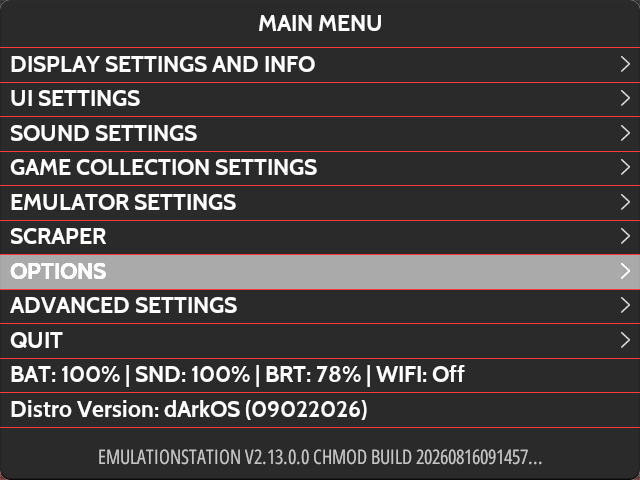
*Figure 1: Press START and open OPTIONS.*

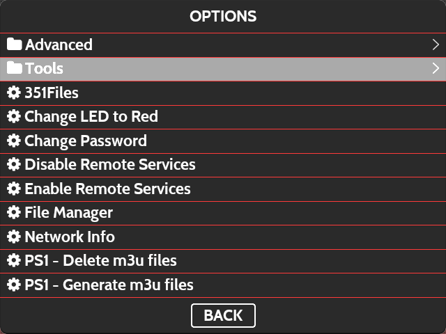
*Figure 2: Select Tools.*

**`USB_Network_Manager`** is listed alongside *PortMaster* and *ThemeMaster*:

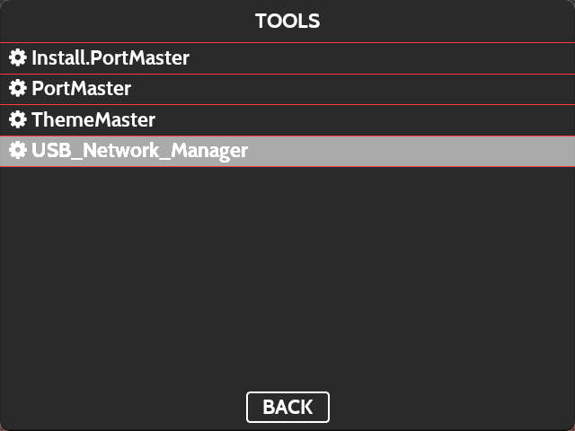
*Figure 3: USB_Network_Manager in the Tools menu.*

*If you used `ports/`:* navigate to **PORTS** on the main carousel.

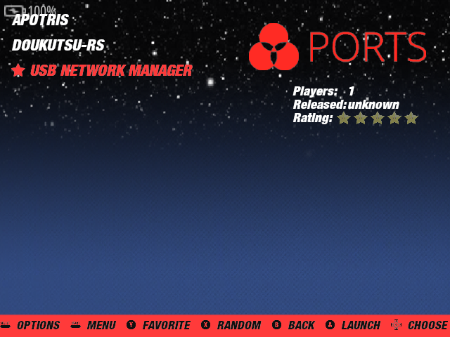
*Figure 4: USB Network Manager in the Ports list.*

> [!TIP]
> **Refreshing without a reboot.** If you copied the file while EmulationStation
> was already running, open any collection (Ports, GBA, SNES…), press **SELECT**
> and choose **Update Game List**. The entry appears immediately.

---

## 🕹️ 4. Start services on the console

> [!IMPORTANT]
> **Order matters.** Start the services on the console **before** configuring
> Windows. If the console is in USB Host mode, or the `g_ether` gadget is not
> loaded, the PC will not see any USB device and no network adapter will appear.

### Step 1 — Connect the cable

Plug the **USB-A** end into the PC and the **USB-C** end into the console's
**OTG / DC** port.

### Step 2 — Launch the dashboard

Open **TOOLS** (or **PORTS**) and launch **`USB Network Manager`**. The dashboard
shows the live connection and hardware mode on the console screen:

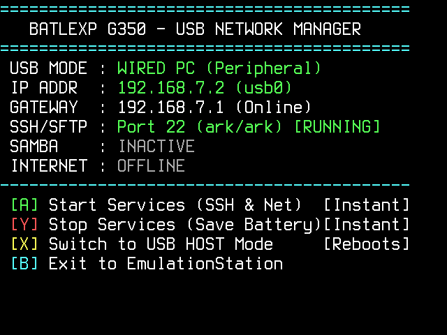
*Figure 5: The dashboard on the Battle XP G350 display.*

### Dashboard controls

| Button | Action | Speed | What it does |
| :---: | :--- | :--- | :--- |
| **[X]** | Switch hardware mode | reboots (~5 s) | Toggles the USB PHY between **Wired PC** and **USB Host** |
| **[A]** | Start wired services | ~2 s | Loads `g_ether`, assigns both console addresses, starts OpenSSH and Samba |
| **[Y]** | Stop services | ~1 s | Stops the daemons to save battery while gaming |
| **[B]** | Exit | instant | Returns to EmulationStation |

### Step 3 — Check the mode, then press [A]

1. Read **`USB MODE`** at the top of the screen.
   * **`WIRED PC (Peripheral)`** — correct, continue.
   * **`USB HOST (OTG Pendrives)`** — press **[X]**, let the console reboot, then
     launch the dashboard again.
2. Press **[A]**. Within about two seconds the console brings up `usb0` and
   starts SSH and Samba.

> [!TIP]
> Windows plays a device-connection chime once the gadget is live. That means the
> adapter now exists and is ready to configure.

---

## 🖥️ 5. Configure Windows (one-time)

Windows will show a new adapter named **`Remote NDIS based Internet Sharing
Device`**, usually numbered **Ethernet 2**.

Two settings, done once:

1. **A static address on that adapter** (`192.168.7.1`). Leave it in place
   permanently.
2. **Internet sharing on your Wi-Fi adapter**, switched on only when the console
   needs internet.

### Step 1 — Static address on the console adapter

> [!IMPORTANT]
> This is set once and then left alone. It does not need to be changed when you
> toggle internet sharing.

1. Press `Win + R`, type `ncpa.cpl` and press **Enter**.

   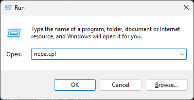
   *Figure 6: Open Network Connections.*

2. Right-click the console adapter and choose **Properties**.

   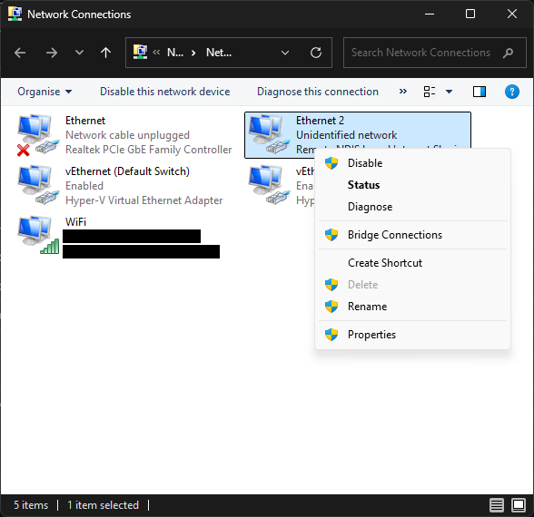
   *Figure 7: The Remote NDIS adapter.*

3. Double-click **Internet Protocol Version 4 (TCP/IPv4)**.

   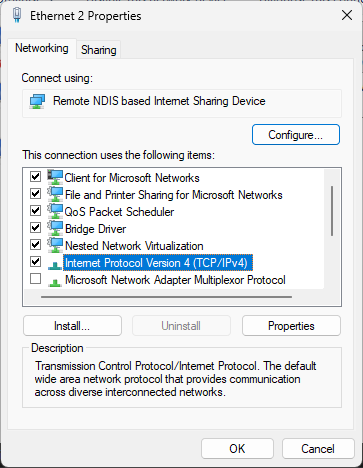
   *Figure 8: Open the IPv4 settings.*

4. Choose **Use the following IP address** and enter:
   * **IP address:** `192.168.7.1`
   * **Subnet mask:** `255.255.255.0`
   * **Default gateway:** leave blank

   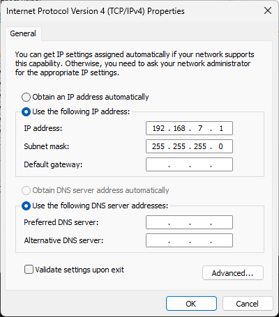
   *Figure 9: 192.168.7.1 with a /24 mask and no gateway.*

5. Click **OK**, then **OK** again.

### Step 2 — Share the PC's internet

1. In `ncpa.cpl`, right-click your active **Wi-Fi** adapter and choose
   **Properties**.

   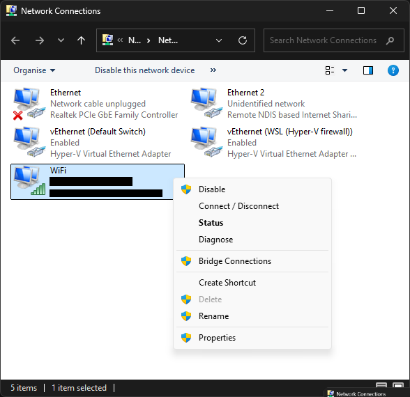
   *Figure 10: Select the Wi-Fi adapter.*

2. Open the **Sharing** tab.
3. Tick **Allow other network users to connect through this computer's Internet
   connection**.
4. Under *Home networking connection*, choose the console's adapter
   (**Ethernet 2**).
5. Click **OK**.

   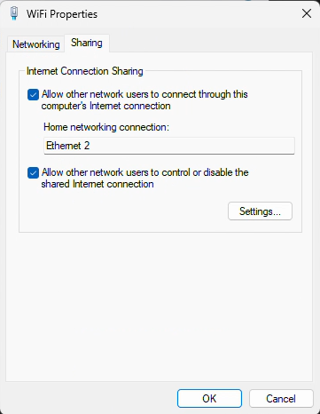
   *Figure 11: Share the Wi-Fi connection with Ethernet 2.*

> [!TIP]
> **Verify it on the console.** Within a few seconds of clicking OK, **`GATEWAY`**
> changes to `192.168.137.1 (Online)` and **`INTERNET`** changes to
> `ONLINE (PortMaster Ready)`. If it has not updated, press **[A]** on the
> handheld to force a status refresh.

### The rule for daily use

* 🌐 **Need internet on the console** (PortMaster, scraping, updates):
  sharing **ON** in `ncpa.cpl`.
* ⚡ **Need to move files** (WinSCP, FileZilla, Explorer): connect to the address
  that matches the current mode.

| Sharing | PC adapter | Connect to |
| :--- | :--- | :--- |
| **ON** (Windows ICS) | `192.168.137.1` | **`192.168.137.2`** |
| **OFF** (direct) | `192.168.7.1` | **`192.168.7.2`** |

The console answers on both addresses and shows the active one under `IP ADDR`.
You do **not** need to turn sharing off to transfer files.

---

## 🚀 6. Daily workflows

### Workflow A — PortMaster without Wi-Fi

1. Connect the USB cable to the console's **OTG / DC** port.
2. Launch **USB Network Manager** from **TOOLS** (or **PORTS**).
3. Press **[A]**. Within two seconds `INTERNET : ONLINE` appears.
4. Make sure Windows Wi-Fi sharing is **ON** in `ncpa.cpl`.
5. Press **[B]** to return to EmulationStation.
6. Open **PortMaster** and download ports over the PC's connection.
7. When finished, reopen **USB Network Manager** and press **[Y]** to stop the
   daemons and save battery.

### Workflow B — Transfer files with Windows Explorer (Samba)

> [!NOTE]
> **Samba is not fully tested.** Windows 11 blocks unauthenticated guest shares by
> default and may need extra configuration.
> **Workflow C (SFTP) is recommended instead** — it is verified and reliably fast.

1. Connect the cable and press **[A]**.
2. Press `Win + E` to open File Explorer.
3. Type `\\192.168.7.2\roms` in the address bar and press **Enter**.
4. If asked for credentials: username `ark`, password `ark`.
5. Drag game files into the system folders (`gba`, `snes`, `psx`, …).

### Workflow C — Transfer files with SFTP (recommended)

> [!NOTE]
> **Which address?** Use the `IP ADDR` shown on the console screen.
> Sharing **ON** → `192.168.137.2`. Sharing **OFF** → `192.168.7.2`.
> Both work, and sharing does not need to be turned off.

> [!TIP]
> No SFTP client yet? [Download WinSCP](https://winscp.net/eng/download.php) from
> the official site.

1. Connect the cable and press **[A]**.
2. Note the `IP ADDR` on the console screen.
3. Open **WinSCP** and click **+** or **New Tab**.

   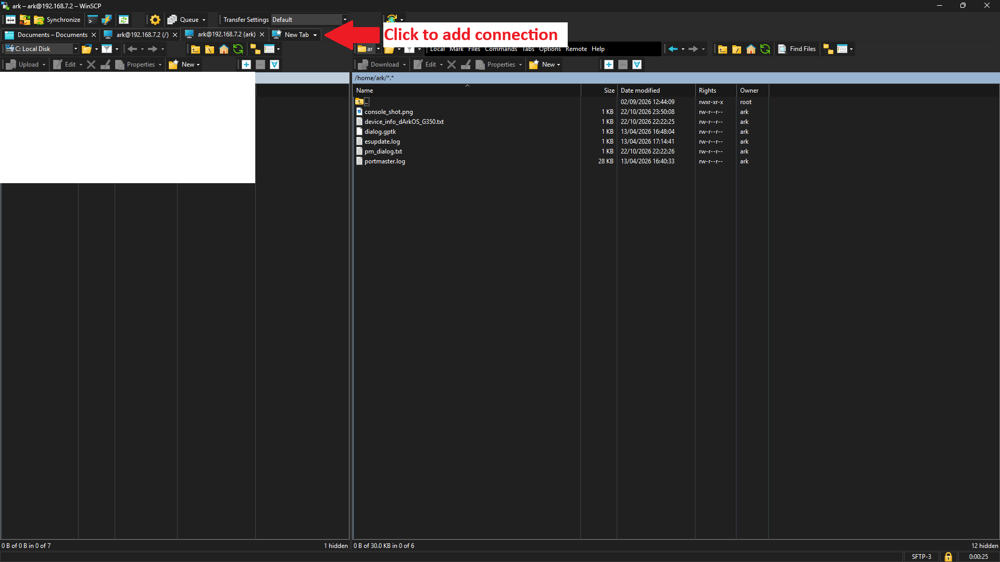
   *Figure 12: Add a new connection.*

4. Enter:
   * **Protocol:** `SFTP`
   * **Host:** `192.168.137.2` (sharing on) or `192.168.7.2` (sharing off)
   * **Port:** `22`
   * **Username:** `ark`
   * **Password:** `ark`

   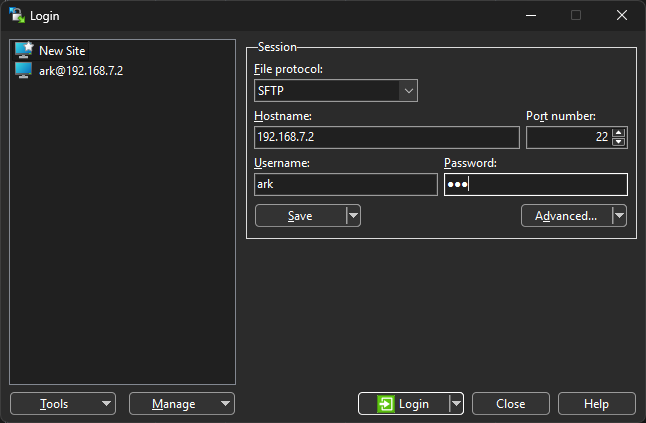
   *Figure 13: SFTP login parameters.*

   > [!TIP]
   > Click **Save** beneath the username field to store the session, so the next
   > connection is a double-click.

5. Click **Login**. WinSCP opens in `/home/ark/`.
6. Click the path bar.

   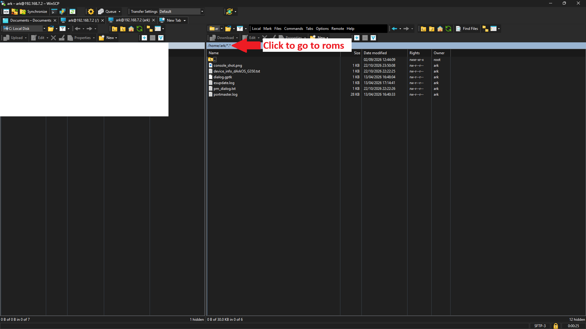
   *Figure 14: Click the directory path bar.*

7. Type **`/roms`** and click **OK**.

   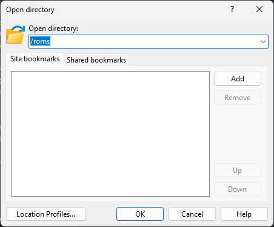
   *Figure 15: Open the games folder.*

8. Drag and drop ROMs into the system folders (`gba`, `snes`, `psx`, …).

### Workflow D — Switch between PC mode and USB Host mode

The RK3326 uses different hardware transceiver configurations for connecting to a
PC (peripheral) versus hosting a drive (host).

* **To use a flash drive or external gamepad:** open **USB Network Manager**,
  press **[X]** (*Switch to USB HOST Mode*), and let the console reboot.
* **To return to PC mode:** open **USB Network Manager**, press **[X]**
  (*Switch to WIRED PC Mode*), let it reboot, then press **[A]** to start
  services.

---

## 🛠️ 7. Test the connection from Windows

The repository includes two one-click test utilities:

| Script | Checks |
| :--- | :--- |
| `Test_Internet_On_G350.bat` | Console ping, a remote ping to `8.8.8.8` from inside the console, and DNS resolution of `github.com` |
| `Test_Connection_G350.bat` | Physical cable link and whether SSH port 22 answers |

Run **`Test_Internet_On_G350.bat`** and read the live output:

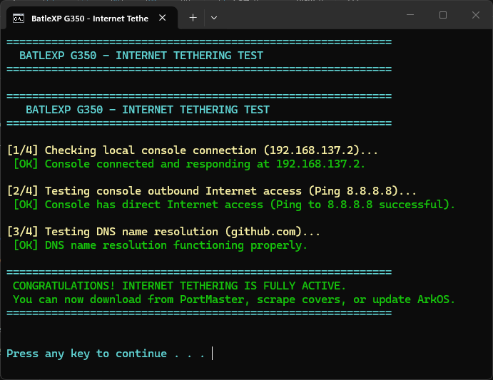
*Figure 16: A passing run of Test_Internet_On_G350.bat.*

---

## ❓ 8. Questions and troubleshooting

### Why must [A] be pressed instead of starting at boot?

ArkOS optimises for battery life and fast game loading. Persistent daemons at boot
consume CPU and battery during offline play, and race with ArkOS's
power-management watchdogs. Starting on demand gives access in about two seconds,
only when it is needed.

### The Windows test says "connected, but no Internet"

The cable is fine; Windows Internet Connection Sharing is not forwarding packets.

1. Open `ncpa.cpl`.
2. Right-click your **Wi-Fi** adapter → **Properties** → **Sharing**.
3. Untick the sharing box, click **OK**, then reopen it, re-tick it, select the
   console adapter and click **OK**. This refreshes the NAT routing table.

### The screen says "REBOOT PENDING"

You pressed **[X]** but cancelled the reboot. The Rockchip transceiver cannot
switch between host and peripheral while Linux is running — the device tree is
loaded at boot. Restart the console to complete the switch.

### Can I use `192.168.7.2` instead of `192.168.137.2`?

Yes. The script assigns **both** addresses to `usb0`. With Windows ICS active the
gateway is `192.168.137.1`; with a manual static address it is `192.168.7.1`.

### Do the `.usb_network` helpers need to be copied to the console?

**No.** Only `USB_Network_Manager.sh` is required. Detection, addressing, gateway
selection, SSH and Samba, and the mode switch are all built in. The
`.usb_network/` folder is optional, for running the same actions from a terminal
or over SSH.

### SSH or SFTP times out

With ICS on, Windows firewall and NAT can intercept inbound traffic to the
console. Check you are using the address for the current mode: sharing **ON** →
`192.168.137.2`, sharing **OFF** → `192.168.7.2`. SFTP works in both modes, so
you can transfer files and share internet at the same time.

### The PC sees no adapter at all

1. Confirm **`USB MODE`** reads **WIRED PC (Peripheral)**. Press **[X]** if not.
2. Confirm services are started (**[A]**) — the gadget is not loaded until then.
3. Try a different USB port on the PC, and a known-good USB-A to USB-C data cable.
4. A disabled adapter in Windows is invisible to some tools. Check
   `Get-NetAdapter` in PowerShell for an entry marked `Disabled`.

---

## 📄 9. Files on the console

```text
/roms/tools/                        (or /roms/ports/)
├── USB_Network_Manager.sh          <-- the only required file
└── .usb_network/                   <-- optional command-line helpers
    ├── Start_Wired_Services.sh
    ├── Stop_Wired_Services.sh
    ├── Switch_USB_Mode.sh
    ├── USB_Status_Check.sh
    └── COMMUNITY_TUTORIAL.md
```

The helpers are not needed for normal use. They exist for running the same actions
over SSH.

---

## 🔗 10. Optional: automate the PC side

Everything in this guide can be done by hand. If you would rather not configure
Windows manually, [G350 Companion](https://github.com/Just-Luis/G350ConnectionManager)
is a Windows app that performs the adapter addressing and internet sharing for
you, and adds screen preview, recording, an SFTP browser and a remote console.

It drives the same script documented here, so install the script first.

---

## 📜 License

MIT. See [LICENSE](LICENSE).

Thanks to the [ArkOS](https://github.com/christianhaitian/arkos) project and the
PortMaster community.
