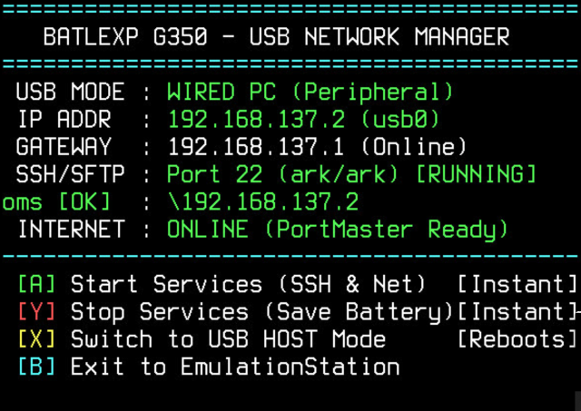

# Battle XP G350 USB Network Manager

A single self-contained shell script that turns a Rockchip RK3326 handheld's USB-C
port into a USB Ethernet gadget, giving a PC tethered internet access, SSH, SFTP
and Samba access to the console over one cable.

[](https://en.wikipedia.org/wiki/Rockchip)
[](https://github.com/christianhaitian/arkos)
[]()
[](LICENSE)

---

## Who this is for

Owners of a Battle XP G350 or a comparable ArkOS / dArkOS handheld that has no
internal Wi-Fi. Without one, loading games means repeatedly removing the MicroSD
card, and PortMaster, box-art scraping and RetroArch core updates are unavailable.

This script bridges that gap: the console appears to the PC as a USB network
adapter, and the PC provides the connection.

For a Windows GUI that drives this script automatically — adapter addressing,
internet sharing, screen preview, recording, SFTP and a remote console — see
[G350 Companion](https://github.com/Just-Luis/G350ConnectionManager).

---

## Screenshots



The dashboard is navigable entirely with the handheld's buttons.

---

## Install

`USB_Network_Manager.sh` is self-contained. Only that one file is required.

1. Shut the console down cleanly (`Start` → `Quit` → `Shutdown`) and remove the
   MicroSD card containing the ROMs partition.
2. Mount the card on a PC and open the `EASYROMS` (or `roms`) partition.
3. Copy `USB_Network_Manager.sh` into one of:
   - **`tools/`** — appears under **TOOLS** in EmulationStation. Recommended.
   - **`ports/`** — appears under **PORTS**. Use this if a theme hides TOOLS.
4. Reinsert the card and power the console on.

The optional `.usb_network/` helpers are not needed for normal use. They are
standalone command-line equivalents of the dashboard actions.

---

## First run

1. Connect a **USB-A to USB-C** cable between the PC and the console's
   **OTG / DC** port.
2. On the console, launch **USB Network Manager** from **TOOLS** (or **PORTS**).
3. Check the **USB MODE** line. It must read **WIRED PC (Peripheral)**. If it
   reads **USB HOST**, press **[X]** and let the console reboot.
4. Press **[A] Start Services**. The USB Ethernet adapter appears on the PC
   within a couple of seconds.
5. On the PC, open `ncpa.cpl` (`Win + R`, type `ncpa.cpl`), locate the console's
   adapter (*Remote NDIS based Internet Sharing Device*) and set a static IPv4
   address of `192.168.7.1`, mask `255.255.255.0`, gateway blank.
6. To give the console internet access, open the Wi-Fi adapter's **Properties →
   Sharing** tab, enable *Allow other network users to connect through this
   computer's Internet connection*, and select the console's adapter.

For a step-by-step walkthrough with screenshots and troubleshooting, see
[COMMUNITY_TUTORIAL.md](COMMUNITY_TUTORIAL.md).

That guide covers the manual Windows setup and needs nothing but this script. If
you would rather have a Windows app perform the adapter addressing and internet
sharing — and add screen preview, recording, an SFTP browser and a remote console
— see [G350 Companion](https://github.com/Just-Luis/G350ConnectionManager), which
drives this same script.

> [!WARNING]
> Use a **USB-A to USB-C** cable. Budget handhelds lack the CC pull-down
> resistors needed for USB-C to USB-C links, which will not enumerate.

---

## Dashboard controls

| Button | Action | Notes |
| :---: | :--- | :--- |
| **[A]** | Start Services | Assigns addresses, sets the gateway, starts SSH and Samba |
| **[Y]** | Stop Services | Stops the daemons to conserve battery |
| **[X]** | Switch USB Mode | Toggles between Wired PC and USB Host; the console reboots |
| **[B]** | Exit | Returns to EmulationStation |

Services run only when started. Offline gaming consumes no background power.

---

## Features

| Feature | Detail |
| :--- | :--- |
| **PortMaster without Wi-Fi** | Download, install and update native ports on the console itself |
| **Metadata scraping** | Scrape covers, screenshots and descriptions in EmulationStation |
| **SFTP transfers** | WinSCP, FileZilla or Cyberduck on port 22, user `ark`, password `ark` |
| **Samba share** | Reach the ROMs partition from Windows File Explorer |
| **Hardware mode switch** | Toggle between Wired PC and USB Host to use flash drives or gamepads |
| **DNS preservation** | Saves and restores `resolv.conf` across service stop and start |
| **Machine-callable modes** | `--refresh-net`, `--set-gateway` and `--start-services` for remote control |

### Network scheme

Two address ranges are used, and they are protocol constants rather than local
settings:

| State | PC adapter | Console | Gateway |
| :--- | :--- | :--- | :--- |
| Direct (sharing off) | `192.168.7.1/24` | `192.168.7.2` | `192.168.7.1` |
| Windows ICS (sharing on) | `192.168.137.1/24` | `192.168.137.2` | `192.168.137.1` |

The console assigns **both** addresses to its USB interface and installs the
default route through whichever gateway answers. Windows Internet Connection
Sharing always uses `192.168.137.x`, while the documented manual setup uses
`192.168.7.x`, so SSH and SFTP keep working in either state and sharing does not
need to be turned off to transfer files.

Console credentials are the ArkOS defaults: user `ark`, password `ark`, port
`22`. ROMs live under `/roms/`.

---

## Command-line interface

The script accepts non-interactive arguments so a PC can drive it over SSH. With
no argument it behaves exactly as before and starts the gamepad dashboard.

```bash
# same as pressing [A], without touching the display
bash /roms/tools/USB_Network_Manager.sh --start-services

# re-apply addresses and the default route only; no service restarts
bash /roms/tools/USB_Network_Manager.sh --refresh-net

# force the default route through a specific gateway
bash /roms/tools/USB_Network_Manager.sh --set-gateway 192.168.137.1
```

`--refresh-net` prints one line, for example `gateway=192.168.137.1 ip=192.168.137.2`.
It does not unload the gadget or restart the SSH server, so it is safe to call
over the connection it is repairing.

See [docs/CONSOLE_CONTROL_INTERFACE.md](docs/CONSOLE_CONTROL_INTERFACE.md) for
the full interface description.

---

## Additional tools

| File | Purpose |
| :--- | :--- |
| `Test_Connection_G350.bat` | Windows: checks the physical link and whether SSH port 22 answers |
| `Test_Internet_On_G350.bat` | Windows: checks the link, pings `8.8.8.8` and resolves DNS |
| `.usb_network/Start_Wired_Services.sh` | Command-line equivalent of **[A]** |
| `.usb_network/Stop_Wired_Services.sh` | Command-line equivalent of **[Y]** |
| `.usb_network/Switch_USB_Mode.sh` | Command-line equivalent of **[X]** |
| `.usb_network/USB_Status_Check.sh` | Prints link, address and service state |
| `.usb_network/Stream_Screen.py` | Mirror the console screen to the PC over SSH |
| `.usb_network/C2C_Connection_Test.sh` | Console-to-console link test |
| `.usb_network/c2c_setup.sh` | Configure a console for direct console-to-console play |
| `.usb_network/Revert_Netplay.sh` | Undo the netplay configuration |

The C2C helpers mirror the canonical versions in
[RK3326-USB-Netplay](https://github.com/Just-Luis/RK3326-USB-Netplay), so this
repository stays usable without cloning the other one.

---

## Requirements

- Battle XP G350 or comparable RK3326 handheld running ArkOS / dArkOS
- A USB-A to USB-C data cable
- A Windows, macOS or Linux PC with a spare USB port

Other RK3326 ArkOS devices with a single USB-C OTG port, such as the Anbernic
RG351P/M/V, Powkiddy RGB20S and RK2020, are expected to work; testing has
focused on the G350.

---

## Related projects

- **[G350 Companion](https://github.com/Just-Luis/G350ConnectionManager)** —
  Windows GUI that drives this script over SSH.
- **[RK3326-USB-Netplay](https://github.com/Just-Luis/RK3326-USB-Netplay)** —
  console-to-console wired netplay for the same hardware.

---

## Contributing

See [CONTRIBUTING.md](CONTRIBUTING.md) for the commit convention, release
process and manual test procedure.

---

## License

Licensed under the [MIT License](LICENSE).

Thanks to the [ArkOS](https://github.com/christianhaitian/arkos) project and the
PortMaster community.
