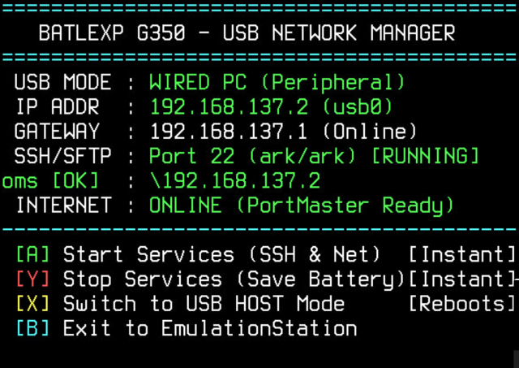

# 🎮 Battle XP G350 USB Network Manager

> **Direct USB wired tethering, PortMaster downloads, high-speed SFTP transfers, and Samba file sharing for the Battle XP G350 and Rockchip RK3326 handhelds running ArkOS / dArkOS.**

---

## 📖 Beginner's Guide & Full Tutorial

> [!TIP]
> ### 🚀 First time setting this up?
> **👉 Read the complete, step-by-step community tutorial: [COMMUNITY_TUTORIAL.md](COMMUNITY_TUTORIAL.md)**
>
> A complete, beginner-friendly walkthrough with visual diagrams and FAQs:
> * 💾 **Installation:** Where to paste `USB_Network_Manager.sh` (`tools/` vs `ports/`).
> * 🔌 **Hardware Requirements:** Which USB cable to use (and which to avoid).
> * 🕹️ **Console Setup:** Switching modes and launching services on your handheld.
> * 🖥️ **Windows Tethering:** Sharing your PC's Wi-Fi connection with the console in 3 clicks.
> * 📁 **Daily Use:** Downloading games from PortMaster and transferring ROMs over SFTP/Samba.

---

### 📋 GitHub Repository Setup (For Maintainers)
If you are publishing or cloning this repository, here is the recommended metadata:
* **Repository Name:** `Battle-XP-G350-USB-Network-Manager`
* **Short Description (About box):**  
  `Direct USB PC tethering, PortMaster internet access, high-speed SFTP/Samba transfers, and hardware USB mode switcher for Battle XP G350 (RK3326) on ArkOS.`
* **Topics / Tags:**  
  `arkos`, `rk3326`, `battle-xp-g350`, `portmaster`, `retro-handheld`, `rndis`, `usb-ethernet`, `sftp`, `retrogaming`, `emulationstation`

---

## 💡 Why This Project?

The **Battle XP G350** is an incredible budget retro gaming handheld powered by the Rockchip RK3326 SoC, but it suffers from one major limitation: **it has no internal Wi-Fi chip**.

Traditionally, this forced owners to:
* 🛑 **Repeatedly remove the MicroSD card** to add games, risking card corruption and wearing out the spring-loaded slot.
* 🛑 **Carry bulky external Wi-Fi dongles** and OTG adapters that drain battery and protrude awkwardly.
* 🛑 **Miss out on PortMaster**, box-art scraping, and RetroArch core updates due to lack of network connectivity.

**USB Network Manager** solves this completely. By converting the console's physical USB-C port into a bidirectional USB Ethernet network gadget, you get:
* 🌐 **Full Internet on your Handheld** via your PC's Wi-Fi connection (Windows Internet Sharing).
* ⚡ **Blazing Fast Game Transfers** up to 25–35 MB/s via SFTP (WinSCP, FileZilla) and Windows File Explorer (`\\192.168.137.2\roms`).
* 🕹️ **Zero Clutter:** A single, self-contained interactive script (`USB_Network_Manager.sh`) driven entirely by your console's gamepad.

---

## 🌟 Key Features

* 🚀 **PortMaster Without Wi-Fi:** Download, install, and update native ports (*Celeste, Stardew Valley, TMNT, Half-Life*, etc.) directly on your handheld.
* 🖼️ **Box-Art & Metadata Scraping:** Scrape covers, screenshots, and descriptions directly inside EmulationStation.
* 📁 **Windows File Explorer Integration:** Drag and drop ROMs directly into `\\192.168.137.2\roms` as if it were a local network drive.
* 🔒 **Instant-Login OpenSSH Server:** Custom PAM and entropy patches eliminate the 15-second SSH hangs common on RK3326 devices.
* 🎮 **Native Gamepad Interface:** Clean on-screen menu navigable entirely with your console's physical buttons (A, Y, X, B).
* 🔄 **Hardware Mode Switcher:** Toggle between **Wired PC (Peripheral)** and **USB Host (OTG)** mode on the fly to support USB flash drives and external gamepads.
* 🕹️ **Direct Console-to-Console (C2C) Netplay:** Connect two handhelds directly over a USB cable for zero-latency ($< 0.5\text{ ms}$) offline 2-player multiplayer without Wi-Fi or routers.
* 🔋 **Battery-Friendly:** Network services only run on-demand when you explicitly press `[A]`. Offline gaming consumes zero background power.

---

## 🕹️ The Handheld Dashboard

Launch **`USB Network Manager`** from **TOOLS** (or **PORTS**) on your console:

### Gamepad Controls:

| Button | Function | Execution | Description |
| :---: | :--- | :---: | :--- |
| **[A]** | **Start Services** | Instant (~2s) | Binds IPs, sets gateway, and launches OpenSSH & Samba. |
| **[Y]** | **Stop Services** | Instant (~1s) | Turns off background daemons to conserve battery during gaming. |
| **[X]** | **Switch USB Mode** | Reboots (5s) | Toggles physical hardware between Wired PC and USB Host (OTG). |
| **[B]** | **Exit** | Instant | Returns cleanly to EmulationStation. |

---

## ⚡ Quick Start Guide (3 Simple Steps)

### Step 1: Copy the Script to Your Console First!
> [!IMPORTANT]
> `USB_Network_Manager.sh` is **100% self-contained**. You only need this single file!

1. Shut down your console safely (`Start` -> `Quit` -> `Shutdown`).
2. Insert your MicroSD card (the ROMs/Game card) into your PC.
3. Open the **`EASYROMS`** (or `roms`) partition in File Explorer.
4. Copy **`USB_Network_Manager.sh`** and paste it into:
   * **`tools/` (⭐ STRONGLY RECOMMENDED):** Appears under **TOOLS** alongside PortMaster and ThemeMaster.
   * **`ports/` (Alternative):** Appears under **PORTS** alongside port games.
5. Reinsert the card into your console and turn it on.

---

### Step 2: Connect Cable & Start Services on Handheld
> [!WARNING]
> **Use a USB-A to USB-C cable!** Avoid USB-C to USB-C cables as budget handhelds lack CC pull-down resistors.

1. Connect the USB cable between your PC and the console's **OTG / DC** port.
2. On your console, navigate to **TOOLS** (or **PORTS**) and launch **`USB Network Manager`**.
3. Verify **`USB MODE`**:
   * If it says **`WIRED PC (Peripheral)`**, proceed.
   * If it says **`USB HOST`**, press **`[X]`** to switch and let the console reboot.
4. Press **`[A]`** (*Start Services*). In 2 seconds, the virtual USB Ethernet adapter will initialize!

---

### Step 3: Configure Windows Network (One-Time Setup)

Open Network Connections on your Windows PC (`Win + R`, type `ncpa.cpl`, and hit **Enter**). You will see the console's adapter (**`Ethernet 2`** / *Remote NDIS based Internet Sharing Device*).

#### 1. Configure Static IP on `Ethernet 2` (Always keep configured like this):
1. Right-click the console adapter (**`Ethernet 2`** / *Remote NDIS*) -> Select **Properties**.
2. Double-click **Internet Protocol Version 4 (TCP/IPv4)**.
3. Select **Use the following IP address**:
   * **IP address:** `192.168.7.1`
   * **Subnet mask:** `255.255.255.0`
   * **Default gateway:** *(leave blank)*
4. Click **OK** and save. *(Keep Ethernet 2 permanently set to this)*.

#### 2. Configure Wi-Fi Sharing (When you want Internet):
1. Right-click your active **Wi-Fi** adapter -> Select **Properties** -> **Sharing** tab.
2. Check **"Allow other network users to connect through this computer's Internet connection"** and select **`Ethernet 2`**. Click **OK**.
3. Check your console screen: **`GATEWAY`** will show `192.168.137.1 (Online)` and **`INTERNET`** will say `ONLINE (PortMaster Ready)`!

#### 🔄 Daily Use Summary:
* 🌐 **For Internet (PortMaster, Scraping):** Turn Wi-Fi sharing **ON** in `ncpa.cpl`.
* ⚡ **For ROM Transfers (WinSCP, Samba):** Connect via SFTP (port 22, `ark`/`ark`) to **`192.168.137.2`** while Wi-Fi sharing is ON, or **`192.168.7.2`** when it is OFF. You do **not** need to turn sharing off to transfer files.

---

## 🎮 Direct Console-to-Console (C2C) Netplay & Multiplayer

Connect two Battle XP G350 (or RK3326 ArkOS) handhelds directly together via a USB cable for **zero-latency, sub-millisecond offline multiplayer** and live controller input mirroring.

> 📖 **Complete Walkthroughs:**
> * **[C2Cconnection/NETPLAY_GUIDE.md](C2Cconnection/NETPLAY_GUIDE.md):** Comprehensive step-by-step 2-player RetroArch Netplay setup, port monitoring, and hardware rules.
> * **[C2Cconnection/C2C_QUICK_START.md](C2Cconnection/C2C_QUICK_START.md):** Quick start reference and live gamepad input testing.

### ⚡ How C2C Works:
1. **Hardware Role Requirement:**
   * **Console 1 (Player 1 / Host):** Set to **USB HOST Mode** via `USB_Network_Manager.sh`.
   * **Console 2 (Player 2 / Client):** Set to **WIRED PC Mode (Peripheral)** via `USB_Network_Manager.sh`.
2. **Safe Cabling:**
   * **⭐ Best & Safest:** Use a **USB-C Male to USB-A Female OTG adapter** on **Console 1 (Host)** connected via a standard **USB-A to USB-C cable** to **Console 2**.
   * ⚠️ *Avoid direct USB-C to USB-C cables, as budget handhelds lack CC pull-down resistors and can risk reverse 5V battery damage.*
3. **1-Click Netplay Preparation:**
   * Run **`C2C_Netplay_Prep.sh`** on both consoles. It automatically assigns static IPs (`192.168.10.1` and `192.168.10.2`), kills conflicting link-local daemons, and patches `retroarch.cfg` to disable Relay Servers and NAT Traversal offline.
4. **Instant 2-Player Gaming:**
   * Player 1 launches game ➔ `[Select] + [X]` ➔ **Netplay** ➔ **Host** ➔ **Start Netplay Host**.
   * Player 2 launches game ➔ `[Select] + [X]` ➔ **Netplay** ➔ **Connect to Netplay Host**.

---

## 📁 Repository Contents

| File / Directory | Purpose |
| :--- | :--- |
| **[`USB_Network_Manager.sh`](USB_Network_Manager.sh)** | **The main console tool.** Single self-contained script for PC tethering and hardware mode switching. |
| **[`C2Cconnection/`](C2Cconnection/)** | **Console-to-Console (C2C) Suite.** Direct USB connection tools, 2-player Netplay prep, and live input visualizer. |
| **[`C2Cconnection/NETPLAY_GUIDE.md`](C2Cconnection/NETPLAY_GUIDE.md)** | Complete step-by-step guide for offline 2-player RetroArch Netplay over USB. |
| **[`C2Cconnection/C2C_QUICK_START.md`](C2Cconnection/C2C_QUICK_START.md)** | Quick start guide for C2C connection testing and gamepad input streaming. |
| **[`COMMUNITY_TUTORIAL.md`](COMMUNITY_TUTORIAL.md)** | **Complete Community Guide.** In-depth PC tethering tutorial with detailed walkthroughs and FAQs. |
| **[`Test_Internet_On_G350.bat`](Test_Internet_On_G350.bat)** | 1-Click Windows batch tool to test physical link, remote ping (8.8.8.8), and DNS resolution. |
| **[`Test_Connection_G350.bat`](Test_Connection_G350.bat)** | 1-Click Windows batch script to test local USB connection and SSH port 22 response. |
| **[`.usb_network/`](.usb_network/)** | *(Optional)* Modular sub-scripts for headless execution over SSH. |

---

## 🖥️ Connecting from PC (Credentials & Paths)

* **SFTP / SSH Connection:**
  * **Host:** `192.168.137.2` *(or `192.168.7.2`)*
  * **Port:** `22`
  * **Username:** `ark`
  * **Password:** `ark`
  * **ROMs Directory:** `/roms/`
* **Windows File Explorer (Samba):**
  * Type `\\192.168.137.2\roms` in the File Explorer address bar.

---

## 🛠️ Hardware & OS Compatibility

* **Primary Target:** Battle XP G350 (Rockchip RK3326) running dArkOS / ArkOS.
* **Compatible Devices:** Other RK3326-based handhelds running ArkOS (e.g. Anbernic RG351P/M/V, Powkiddy RGB20S, RK2020) with single USB-C OTG ports.

---

## 📜 License & Acknowledgments

* Licensed under the [MIT License](LICENSE).
* Special thanks to the **ArkOS** development team, the **PortMaster** community, and all retro handheld enthusiasts pushing budget devices to their fullest potential!
